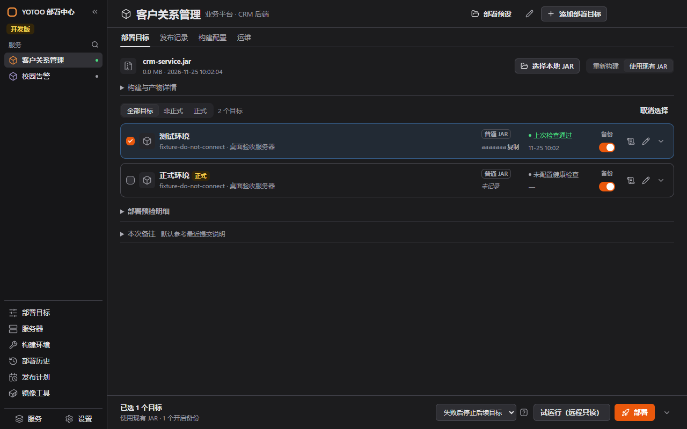
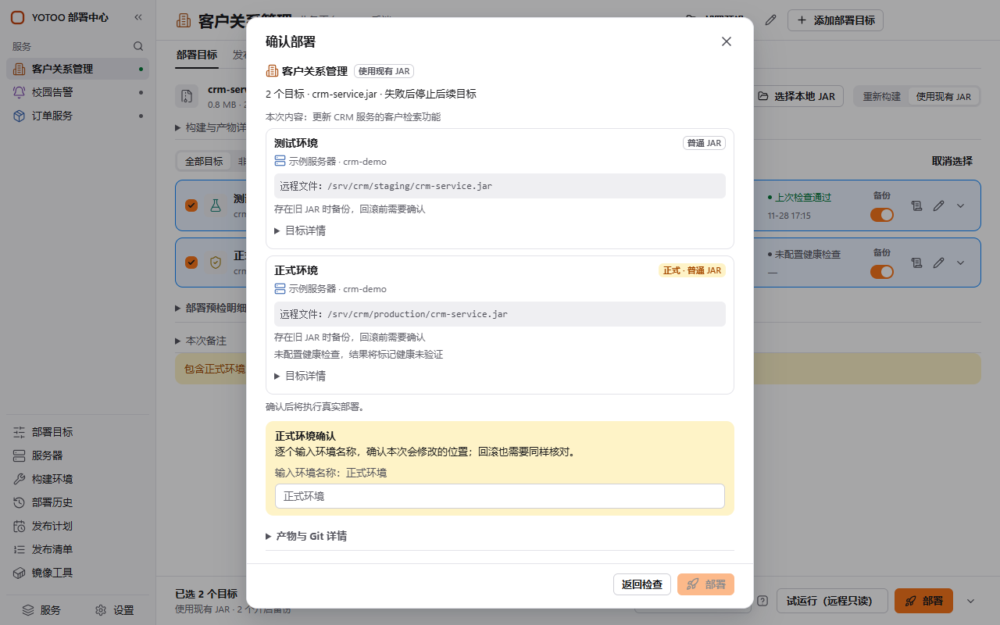
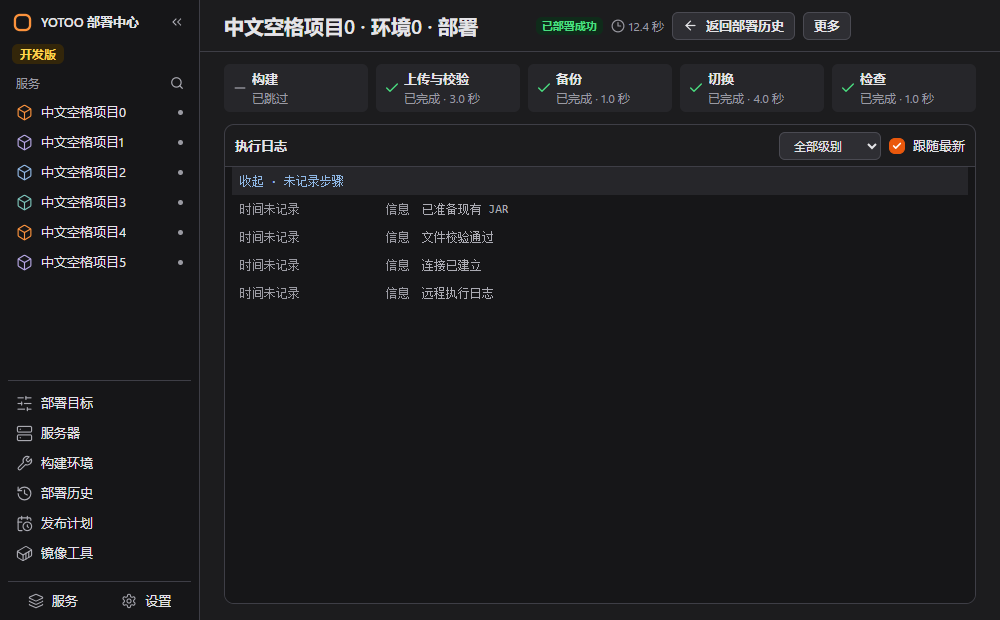

# YOTOO 部署中心

面向 Windows 10 和 Windows 11 x64 的桌面工具，用于构建、部署和运维 Java 服务。版本变更见 [更新日志](docs/CHANGELOG.md)，其他资料见 [文档索引](docs/README.md)。

## 安装与启动

- 下载安装包，按中文向导选择安装目录和桌面快捷方式。默认以普通用户身份安装到当前用户的 Programs 目录，完成后可从开始菜单打开。
- 应用自带运行环境。需要重新构建时，在应用中配置 JDK 和 Maven 或使用项目的 Maven Wrapper。实际部署需要能访问目标服务器。
- 首次打开可查看五步教学向导。已有配置的用户覆盖安装后也会看到一次，之后可从「设置 → 关于与帮助」重看。配置好服务、构建环境、服务器和部署目标后，先在测试环境使用「试运行」。
- 「设置 → 软件更新」提供检查、下载和更新。安装前请结束部署任务并正常退出。覆盖安装沿用原安装目录，安装、更新和默认卸载均保留用户数据。彻底清理数据须在卸载向导中主动选择并确认。

## 功能地图

| 入口 | 用途 |
| --- | --- |
| 服务工作台 | 选择目标，构建或选择已有 JAR，试运行、部署或创建定时发布 |
| 发布计划与部署历史 | 管理定时任务，查看部署结果和完整日志，手动回滚 |
| 运维与线上日志 | 查看运行状态，确认后启停或重启服务，只读查看、搜索和下载线上日志 |
| 镜像工具 | 通过 Windows Docker 或 WSL 构建镜像包，校验后导入服务器 |
| 服务、服务器、部署目标与构建环境 | 管理项目、SSH 连接、目标、JDK 和 Maven |
| 设置 | 管理外观、托盘、更新、数据迁移与备份 |

### 界面截图

**服务工作台** · 选择部署目标和 JAR，发起试运行或部署。



**部署确认** · 核对目标、产物和备份策略。



**任务详情** · 查看部署阶段、结果和执行日志。



## 数据目录与安全规则

数据位置以「设置 → 数据与备份」为准。首次未配置时使用系统 AppData，当前用户注册表仅记录数据目录位置。程序文件单独安装。开发版使用独立的目录定位，验收使用隔离数据。

| 数据 | 数据目录中的位置 |
| --- | --- |
| 配置与部署历史 | `deploy-center.sqlite` |
| 完整任务日志与更新日志 | `logs/<任务 ID>/`、`logs/update/` |
| 应用、崩溃与安装日志 | `logs/application/`、`logs/crashes/`、`logs/installer/` |
| 共享产物与更新缓存 | `artifacts/`、`Updates/` |
| 运行缓存与临时文件 | `Runtime/`、`tmp/` |
| 迁移记录、数据库备份与升级备份 | `Control/`、`backups/`、`installer-backups/` |

- 导入配置前校验并备份数据库。密码与私钥通过 SSH2 连接，首次连接须验证指纹，指纹变更须核实并明确确认。SSH 别名由系统 OpenSSH 处理，须事先建立 `known_hosts` 信任。保存在本机的凭据由 Windows DPAPI 加密，配置导出不包含口令。
- 目标服务器需提供 Linux、Bash、GNU coreutils、`/proc`、`flock` 和 SHA-256 工具。Docker 部署额外需要 `docker` 和 `tar`，容器内需有 `sha256sum`。从服务器检查 HTTP 时需有 `curl`。仅提供 BusyBox 命令的环境不受支持，预检会检查实际命令用法。
- 试运行只读。正式部署完整校验 JAR，多目标共用一份已校验产物。先上传并校验，再备份、停服和原子替换。正式目标须逐项确认，弱校验也须单独确认。
- Docker 部署会在上传前用只读命令核验容器内的 `sh` 和 `sha256sum --`。容器需已处于稳定运行状态，试运行和预检不会启动它。
- HTTP 健康检查发出 GET，仅接受配置地址直接返回的 2xx，未配置时标记「健康未验证」。部署失败会保留有效备份，回滚须手动发起并确认。
- 取消等待安全点，异常退出后先核实原任务及远端锁。已有远端锁会阻止部署，接管须核实旧进程已经停止并输入 `TAKEOVER`。中断任务不会自动续跑，也不会被保留策略清理。串行清单遇到启动前拒绝时暂停，处理原因后可手动复核未执行的服务。启动结果未知时须先核实原任务。

## 构建与发布

在仓库根目录执行以下命令。Windows x64 构建使用 better-sqlite3 自带的预编译模块，需要自行重编译时，安装 Visual Studio C++ Build Tools 后运行 `npm run rebuild:native`。

```powershell
npm ci --ignore-scripts
node node_modules/electron/install.js
npm run build
npm start
```

正式安装包使用 NSIS 构建。以下命令按当前版本输出安装包和源码包。

```powershell
$version = (Get-Content -LiteralPath package.json -Raw | ConvertFrom-Json).version
npm run dist -- --x64 "--config.directories.output=D:/AppData/DeployCenter/release/$version"
python scripts/package-source.py --output "release/$version/YOTOO-DeployCenter-$version-source.zip"
```

发布时让 Git 标签与 GitHub Release 标题一致，格式为 `v<版本号>`。附上对应安装包、源码包和 SHA-256 校验清单，源码包和清单保存在仓库的 `release/<版本号>/`。

确认正式包与当前提交一致后，再创建并推送版本标签。

```powershell
$tag = "v$version"
git tag -a $tag -m $tag
git push origin $tag
```

## 测试说明

```powershell
npm run typecheck
npm test
npm run test:smoke
```

原生和桌面测试使用隔离数据。安装、升级和卸载使用独立 QA 应用身份，真实 SSH 测试只使用专用回环或隔离服务。环境不满足的测试会明确跳过。业务服务器验收按 [Linux / Docker 手工清单](docs/linux-docker-acceptance.md) 在专用测试环境执行。
